# Test avec Bruno

# Test de l'API

## POST /api/register - Inscription d'un utilisateur
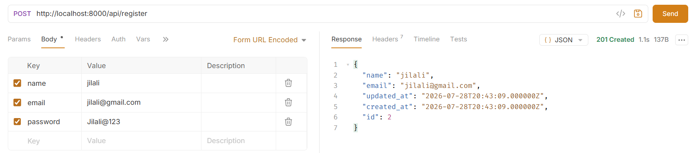

## POST /api/login - Connexion d'un utilisateur
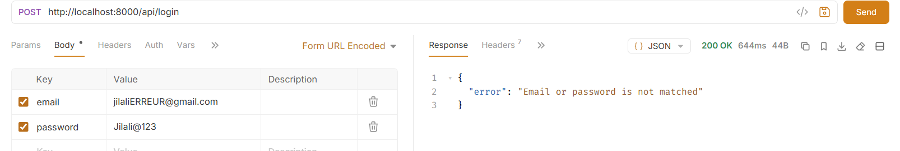
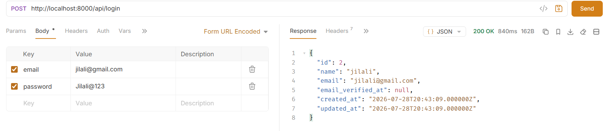

## POST /api/addproduct - Ajouter produit
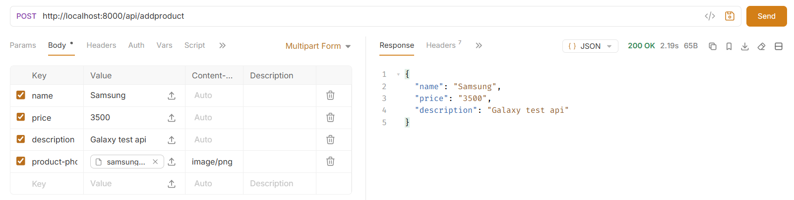

## GET /api/product/{id} - Afficher produit
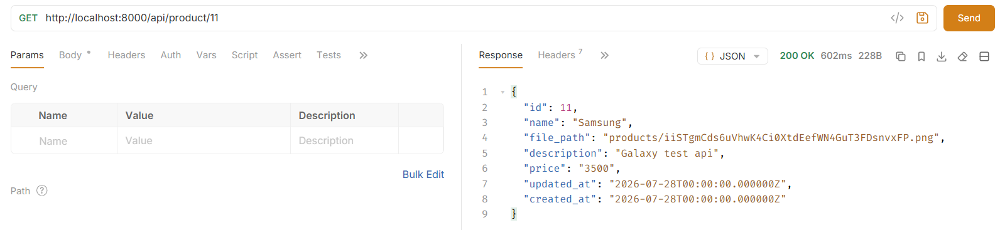

## GET /api/search/{key} - Rechercher produit
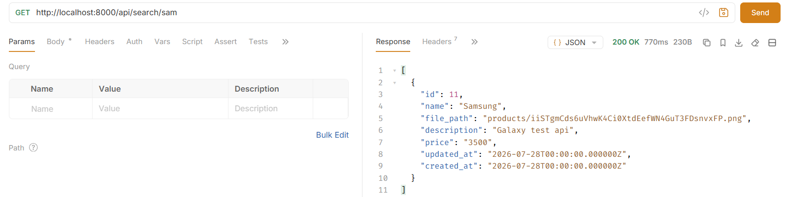
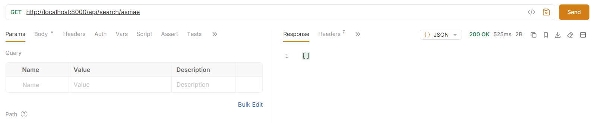
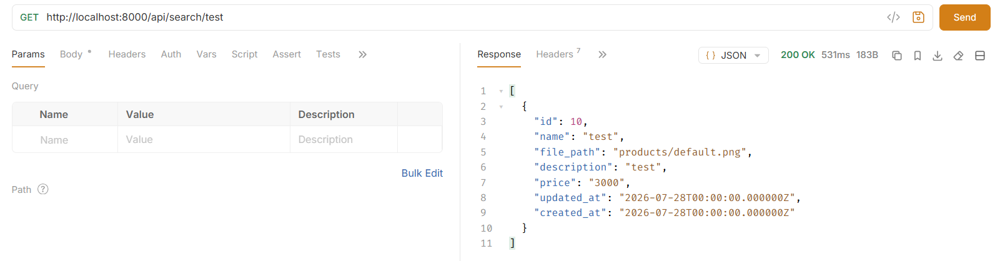

## DELETE /api/delete/{id} - Supprimer produit
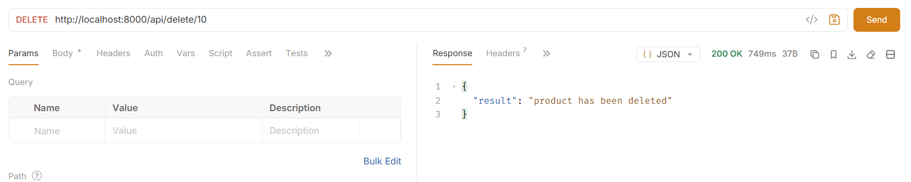
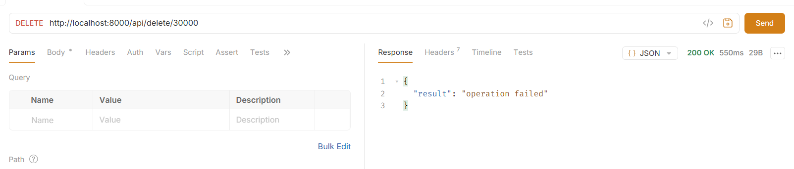

## GET /api/list - Afficher tous les produits
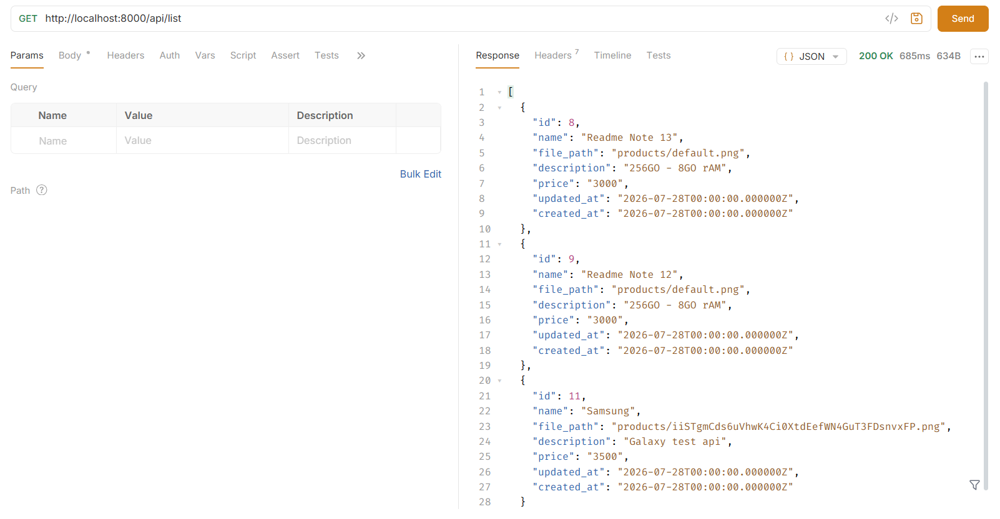